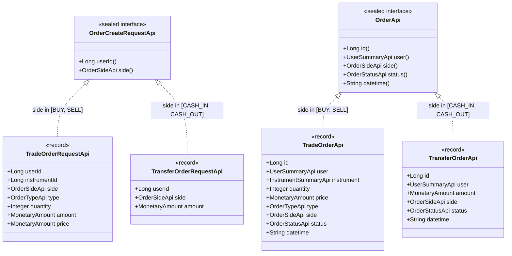

# Plan 008: Polimorfismo en el Contrato API (`OrderCreateRequestApi` & `OrderApi` con `@JsonTypeInfo` / `@JsonSubTypes`), Simetría Bidireccional (`Request -> Response`) y Resolución Automática de Instrumento por Divisa en Transferencias
**Status:** Completed (v5 — Simetría Bidireccional: Eliminación de `instrument` en `OrderApi` y `TransferOrderApi`, Estado `FILLED` Inmediato en Transferencias)
**Context:** Cocos Challenge Trading API
**Architecture:** Multi-Module Pragmatic Service-Driven Architecture (Java 21 Sealed Interfaces & Pattern Matching, Spring Boot 3.3, Hibernate 6 `SINGLE_TABLE` + `@DiscriminatorFormula`, Framework-Agnostic API Contract)

---

## 1. Gentle AI & Engram ReAct Loop — Análisis Arquitectónico

### Thought (Diagnóstico de Inconsistencias Semánticas, Anti-Patrón "Fat DTO" y Simetría Bidireccional `Request -> Response`)
1. **Problema del "Fat DTO"**:
   - Usar un único `record` monolítico (`OrderCreateRequestApi` y `OrderApi`) mezclando atributos bursátiles (`instrumentId` / `instrument`, `quantity`, `price`, `type`) con atributos de transferencias monetarias (`amount`) genera un contrato ambiguo.
   - En la capa JPA ya contamos con herencia polimórfica (`OrderJpaEntity` $\rightarrow$ `TradeOrderJpaEntity` | `TransferOrderJpaEntity`) discriminada por `side`. El contrato público (`cocos-trading-contract`) debe reflejar esta misma separación estructural mediante `sealed interface`s y `@JsonTypeInfo` / `@JsonSubTypes`.
2. **Trade Orders (`MARKET` / `LIMIT` sobre `ACCIONES`, `side` $\in$ `{"BUY", "SELL"}`)**:
   - En `GET /portfolios/{userId}`, las posiciones utilizan `quantity`. En `POST /orders`, las órdenes de renta variable se modelan mediante `TradeOrderRequestApi` y `TradeOrderApi`.
   - `TradeOrderRequestApi` requiere `instrumentId` (el activo bursátil a operar) y `type` (`MARKET` o `LIMIT`), permitiendo dimensionar la orden por `quantity` (acciones exactas) o por `amount` (`MonetaryAmount` de inversión total para `MARKET BUY`), más `price` (`MonetaryAmount` obligatorio en órdenes `LIMIT`).
   - `TradeOrderApi` (respuesta) mantiene como campos exclusivos de la operatoria bursátil `instrument` (`InstrumentSummaryApi`), `quantity`, `price` y `type` (`MARKET` / `LIMIT`), sin el campo `amount`.
3. **Transfer Orders (`CASH_IN` / `CASH_OUT` sobre `MONEDA`, `side` $\in$ `{"CASH_IN", "CASH_OUT"}`) — Simetría Bidireccional y Ejecución Inmediata**:
   - **Eliminación de `type` (Entrada y Salida)**: Un ingreso o egreso de dinero (`CASH_IN` / `CASH_OUT`) no es una orden de ejecución bursátil. Se elimina `type` tanto de `TransferOrderRequestApi` como de `TransferOrderApi`, asignando internamente `OrderType.MARKET` en `ApiMapper` para cumplir la restricción `NOT NULL` de la tabla `orders`.
   - **Eliminación de `instrumentId` en `TransferOrderRequestApi` y de `instrument` en `TransferOrderApi` (Simetría Bidireccional `Request -> Response`)**:
     - En la entrada (`TransferOrderRequestApi`), un cliente que deposita o retira dinero solo envía `userId`, `side` (`CASH_IN` / `CASH_OUT`) y `amount` (`MonetaryAmount` con `amount` y `currency`, ej. `"ARS"`), sin conocer el `instrumentId` interno de la tabla `instruments`.
     - Por **consistencia bidireccional (`Request -> Response`)**, si no le pedimos `instrumentId` en la entrada, tampoco debemos ensuciar la salida (`TransferOrderApi`) de un comprobante de transferencia de efectivo devolviéndole un objeto `instrument` (`InstrumentSummaryApi`) propio de la bolsa. El objeto `amount` (`{ "amount": 50000.00, "currency": "ARS" }`) ya expresa de forma autosuficiente tanto el monto como la divisa transferida.
     - En consecuencia, se remueve `instrument()` del contrato base de respuesta `OrderApi`, se elimina por completo `InstrumentSummaryApi instrument` de `TransferOrderApi` (dejando únicamente `id`, `user`, `amount`, `side`, `status` y `datetime`), y se mantiene `InstrumentSummaryApi instrument` como exclusivo de `TradeOrderApi`.
   - **Resolución Interna en Backend (`Zero DDL Schema Mutation`)**:
     - Al recibir un `TransferOrderRequestApi`, `OrderCreateRequestValidator` valida estrictamente que `amount.currency` sea `"ARS"` (rechazando `"USD"` u otras divisas no soportadas con `400 Bad Request`).
     - `OrderService` resuelve internamente la entidad `InstrumentJpaEntity` buscando en base de datos por `ticker == command.amount().currency()` (`instrumentRepositoryPort.findByTicker("ARS")`), persistiendo la clave foránea `instrumentid = 66` en la tabla `orders` sin alterar el esquema SQL.
   - **Estado (`status`) en Transferencias (`FILLED`)**:
     - Las transferencias de efectivo (`CASH_IN` / `CASH_OUT`) son movimientos de liquidación y ejecución inmediata en el libro mayor de la cuenta. Por regla de negocio, toda transferencia (`CASH_IN` o `CASH_OUT`) exitosa que supere las validaciones de saldo disponible se persiste y retorna **siempre con estado `FILLED`** (o lanza `422 Unprocessable Entity` si un `CASH_OUT` excede el efectivo disponible, sin generar órdenes pendientes `NEW`).

### Action (Diseño de Polimorfismo Puro y Simétrico en el Contrato)
- **`OrderCreateRequestApi` (`sealed interface`)**: Expone únicamente `userId()` y `side()` (sin `instrumentId()` ni `type()`).
  - `TradeOrderRequestApi`: contiene `userId`, `instrumentId`, `side`, `type`, `quantity`, `amount`, `price`.
  - `TransferOrderRequestApi`: contiene **únicamente** `userId`, `side`, `amount` (`MonetaryAmount`).
- **`OrderApi` (`sealed interface`)**: Expone únicamente `id()`, `user()`, `side()`, `status()`, `datetime()` (sin `instrument()` ni `type()`).
  - `TradeOrderApi`: contiene `id`, `user`, `instrument`, `quantity`, `price`, `type`, `side`, `status`, `datetime`.
  - `TransferOrderApi`: contiene **únicamente** `id`, `user`, `amount`, `side`, `status`, `datetime` (sin `instrument`, `type`, `quantity` ni `price`).
- **`ApiMapper.toApi(OrderJpaEntity)`**:
  - En la rama `case TransferOrderJpaEntity transferOrder`: construye `TransferOrderApi` mapeando únicamente `id`, `user`, `amount` (`MonetaryAmount.ars(BigDecimal.valueOf(transferOrder.getQuantity()))`), `side`, `status` (`FILLED`) y `datetime`, omitiendo por completo el campo `instrument`.

### Observation (Verificación de Invariantes)
- **Simetría Bidireccional (`Request -> Response`)**:
  - **Trade (`BUY` / `SELL`)**: Pide `instrumentId` y `type` (`+ quantity | amount`) $\rightarrow$ Devuelve `instrument`, `quantity`, `price` y `type`.
  - **Transfer (`CASH_IN` / `CASH_OUT`)**: Pide `userId`, `side` y `amount` $\rightarrow$ Devuelve `id`, `user`, `amount`, `side`, `status` (`FILLED`) y `datetime`.
- **Zero DDL Schema Mutation**: La tabla `orders` sigue almacenando físicamente `instrumentid = 66`, `size = 50000`, `price = 1.00`, `type = 'MARKET'` y `status = 'FILLED'`.

---

## 2. Estructura Polimórfica del Contrato (`cocos-trading-contract`)



### Ejemplos de Payloads JSON (`POST /orders`)

#### 1A. `TradeOrderRequestApi` (por `quantity`) $\rightarrow$ `TradeOrderApi`
**Request (`side = "BUY"` $\rightarrow$ deserializa `TradeOrderRequestApi`):**
```json
{
  "userId": 1,
  "instrumentId": 47,
  "side": "BUY",
  "type": "MARKET",
  "quantity": 10
}
```
**Response (`TradeOrderApi` — contiene `instrument`, `quantity`, `price` y `type`):**
```json
{
  "id": 12,
  "user": {
    "id": 1,
    "accountNumber": "10001"
  },
  "instrument": {
    "id": 47,
    "ticker": "PAMP"
  },
  "quantity": 10,
  "price": {
    "amount": 925.85,
    "currency": "ARS"
  },
  "type": "MARKET",
  "side": "BUY",
  "status": "FILLED",
  "datetime": "2024-06-15T14:30:00"
}
```

#### 1B. `TradeOrderRequestApi` (por `amount` total a invertir) $\rightarrow$ `TradeOrderApi`
**Request (`side = "BUY"` $\rightarrow$ deserializa `TradeOrderRequestApi`):**
```json
{
  "userId": 1,
  "instrumentId": 47,
  "side": "BUY",
  "type": "MARKET",
  "amount": {
    "amount": 15000.00,
    "currency": "ARS"
  }
}
```
**Response (`TradeOrderApi` — retorna `instrument`, `quantity` calculada, `price` de ejecución y `type`):**
```json
{
  "id": 13,
  "user": {
    "id": 1,
    "accountNumber": "10001"
  },
  "instrument": {
    "id": 47,
    "ticker": "PAMP"
  },
  "quantity": 16,
  "price": {
    "amount": 925.85,
    "currency": "ARS"
  },
  "type": "MARKET",
  "side": "BUY",
  "status": "FILLED",
  "datetime": "2024-06-15T14:31:00"
}
```

#### 2. `TransferOrderRequestApi` (`CASH_IN` / `CASH_OUT` sin `instrumentId` ni `type`) $\rightarrow$ `TransferOrderApi` (sin `instrument`, `type`, `quantity` ni `price`)
**Request (`side = "CASH_IN"` $\rightarrow$ deserializa `TransferOrderRequestApi`, resuelve `ARS` internamente desde `amount.currency`):**
```json
{
  "userId": 1,
  "side": "CASH_IN",
  "amount": {
    "amount": 50000.00,
    "currency": "ARS"
  }
}
```
**Response (`TransferOrderApi` — retorna únicamente `id`, `user`, `amount`, `side`, `status: "FILLED"` y `datetime`, omitiendo `instrument`, `type`, `quantity` y `price`):**
```json
{
  "id": 15,
  "user": {
    "id": 1,
    "accountNumber": "10001"
  },
  "amount": {
    "amount": 50000.00,
    "currency": "ARS"
  },
  "side": "CASH_IN",
  "status": "FILLED",
  "datetime": "2024-06-15T14:35:00"
}
```

> [!IMPORTANT]
> **Regla de Negocio sobre el Estado (`status`) en Transferencias (`CASH_IN` / `CASH_OUT`):**
> Las transferencias de efectivo son movimientos de ejecución inmediata sobre el libro mayor del usuario. Por lo tanto, toda transferencia (`CASH_IN` o `CASH_OUT`) exitosa retorna **siempre `"status": "FILLED"`** en el `TransferOrderApi`. Nunca existen transferencias en estado `"NEW"` (pendientes) ni `"CANCELLED"`.

---

## 3. Pasos de Implementación Detallados

### Paso 1: DTOs Polimórficos de Entrada (`OrderCreateRequestApi`, `TradeOrderRequestApi`, `TransferOrderRequestApi`)
En `cocos-trading-contract/src/main/java/com/cocos/trading/api/request/`:

1. **[OrderCreateRequestApi.java](file:///Users/richard/environment/workspace-richard/cocos-challenge-trading-api/cocos-trading-contract/src/main/java/com/cocos/trading/api/request/OrderCreateRequestApi.java) (`sealed interface`)**:
   - Define únicamente los selectores comunes a toda solicitud (`userId()`, `side()`).
2. **[TradeOrderRequestApi.java](file:///Users/richard/environment/workspace-richard/cocos-challenge-trading-api/cocos-trading-contract/src/main/java/com/cocos/trading/api/request/TradeOrderRequestApi.java) (`record` implementa `OrderCreateRequestApi`)**:
   - Mantiene `Long instrumentId` y `OrderTypeApi type` como campos exclusivos de órdenes bursátiles (`BUY`, `SELL`), junto con `quantity`, `amount` y `price`.
3. **[TransferOrderRequestApi.java](file:///Users/richard/environment/workspace-richard/cocos-challenge-trading-api/cocos-trading-contract/src/main/java/com/cocos/trading/api/request/TransferOrderRequestApi.java) (`record` implementa `OrderCreateRequestApi`)**:
   - Contiene exclusivamente `userId`, `side` y `amount`.

---

### Paso 2: DTOs Polimórficos de Salida (`OrderApi`, `TradeOrderApi`, `TransferOrderApi`)
En `cocos-trading-contract/src/main/java/com/cocos/trading/api/response/`:

1. **[OrderApi.java](file:///Users/richard/environment/workspace-richard/cocos-challenge-trading-api/cocos-trading-contract/src/main/java/com/cocos/trading/api/response/OrderApi.java) (`sealed interface` — remover `instrument()`)**:
   - Remover el método `InstrumentSummaryApi instrument()` de la interfaz base para que solo exponga los campos verdaderamente compartidos entre trades y transferencias (`id()`, `user()`, `side()`, `status()`, `datetime()`):
     ```java
     @JsonTypeInfo(
             use = JsonTypeInfo.Id.NAME,
             include = JsonTypeInfo.As.EXISTING_PROPERTY,
             property = "side",
             visible = true
     )
     @JsonSubTypes({
             @JsonSubTypes.Type(value = TradeOrderApi.class, names = {"BUY", "SELL"}),
             @JsonSubTypes.Type(value = TransferOrderApi.class, names = {"CASH_IN", "CASH_OUT"})
     })
     @Schema(
             description = "Polymorphic representation of a trading order (BUY/SELL) or cash transfer order (CASH_IN/CASH_OUT)",
             discriminatorProperty = "side",
             subTypes = {TradeOrderApi.class, TransferOrderApi.class}
     )
     public sealed interface OrderApi
             permits TradeOrderApi, TransferOrderApi {

         Long id();

         UserSummaryApi user();

         OrderSideApi side();

         OrderStatusApi status();

         String datetime();
     }
     ```
2. **[TradeOrderApi.java](file:///Users/richard/environment/workspace-richard/cocos-challenge-trading-api/cocos-trading-contract/src/main/java/com/cocos/trading/api/response/TradeOrderApi.java) (`record` implementa `OrderApi` — mantiene `instrument`)**:
   - Mantiene `InstrumentSummaryApi instrument` como campo exclusivo de las ejecuciones de órdenes bursátiles (`BUY`, `SELL`):
     ```java
     @Builder
     @JsonInclude(JsonInclude.Include.NON_NULL)
     @Schema(description = "Execution details of an equity trade order (BUY or SELL)")
     public record TradeOrderApi(
             @Schema(description = "Order ID", example = "12")
             Long id,

             @Schema(description = "User who owns the order")
             UserSummaryApi user,

             @Schema(description = "Traded financial instrument")
             InstrumentSummaryApi instrument,

             @Schema(description = "Order quantity (number of shares)", example = "10")
             Integer quantity,

             @Schema(description = "Execution or limit unit price with currency")
             MonetaryAmount price,

             @Schema(description = "Order execution type (MARKET, LIMIT)", example = "MARKET")
             OrderTypeApi type,

             @Schema(description = "Order side (BUY, SELL)", example = "BUY")
             OrderSideApi side,

             @Schema(description = "Order lifecycle status (NEW, FILLED, REJECTED, CANCELLED)", example = "FILLED")
             OrderStatusApi status,

             @Schema(description = "Order creation timestamp (ISO-8601)", example = "2024-06-15T14:30:00")
             String datetime
     ) implements OrderApi {
     }
     ```
3. **[TransferOrderApi.java](file:///Users/richard/environment/workspace-richard/cocos-challenge-trading-api/cocos-trading-contract/src/main/java/com/cocos/trading/api/response/TransferOrderApi.java) (`record` implementa `OrderApi` — eliminar `instrument`)**:
   - Eliminar por completo el campo `InstrumentSummaryApi instrument`. El DTO de respuesta para transferencias contiene **únicamente** `id`, `user`, `amount`, `side`, `status` (siempre `FILLED` en transferencias exitosas) y `datetime`:
     ```java
     @Builder
     @JsonInclude(JsonInclude.Include.NON_NULL)
     @Schema(description = "Execution details of a cash transfer order (CASH_IN or CASH_OUT)")
     public record TransferOrderApi(
             @Schema(description = "Order ID", example = "15")
             Long id,

             @Schema(description = "User who owns the transfer")
             UserSummaryApi user,

             @Schema(description = "Transferred monetary amount with currency")
             MonetaryAmount amount,

             @Schema(description = "Transfer side (CASH_IN, CASH_OUT)", example = "CASH_IN")
             OrderSideApi side,

             @Schema(description = "Transfer execution status (always FILLED for completed cash transfers)", example = "FILLED")
             OrderStatusApi status,

             @Schema(description = "Transfer timestamp (ISO-8601)", example = "2024-06-15T14:35:00")
             String datetime
     ) implements OrderApi {
     }
     ```

---

### Paso 3: Validación en `OrderCreateRequestValidator`
*   **[OrderCreateRequestValidator.java](file:///Users/richard/environment/workspace-richard/cocos-challenge-trading-api/cocos-trading-service/src/main/java/com/cocos/trading/controller/validator/OrderCreateRequestValidator.java):**
    *   En `validate(Object target, Errors errors)`:
        *   Valida únicamente `userId` y `side`, delegando con `switch (request)` exhaustivo a `validateTradeOrder` o `validateTransferOrder`.
    *   En `validateTradeOrder(TradeOrderRequestApi request, Errors errors)`:
        *   Valida `instrumentId`, `type`, exclusión mutua `quantity XOR amount`, valores positivos, moneda `"ARS"`, y `price` obligatorio cuando `type == OrderTypeApi.LIMIT`.
    *   En `validateTransferOrder(TransferOrderRequestApi request, Errors errors)`:
        *   Valida la presencia de `amount`, `amount.amount > 0` y estrictamente `amount.currency == "ARS"` (rechazando `"USD"` u otra moneda no soportada con `400 Bad Request`).

---

### Paso 4: Mapeo en `ApiMapper` y Resolución Interna del Instrumento en `OrderService`
1. **[ApiMapper.java](file:///Users/richard/environment/workspace-richard/cocos-challenge-trading-api/cocos-trading-service/src/main/java/com/cocos/trading/controller/mapper/ApiMapper.java):**
   - En `toCommand(UUID idempotencyKey, OrderCreateRequestApi request)`:
     - En la rama `case TransferOrderRequestApi transfer`: construye `PlaceOrderCommand` sin `instrumentId` (`instrumentId = null`), asignando internamente `.type(OrderType.MARKET)` y `.amount(toDomainMonetaryAmount(transfer.amount()))`.
   - En `toApi(OrderJpaEntity entity)`:
     - Actualizar la rama `case TransferOrderJpaEntity transferOrder` para construir `TransferOrderApi` **omitiendo por completo el campo `instrument`** (además de omitir `type`, `quantity` y `price`):
       ```java
       public static OrderApi toApi(OrderJpaEntity entity) {
           UserSummaryApi userSummary = new UserSummaryApi(
                   entity.getUser().getId(),
                   entity.getUser().getAccountNumber()
           );
           OrderSideApi sideApi = OrderSideApi.valueOf(entity.getSide().name());
           OrderStatusApi statusApi = OrderStatusApi.valueOf(entity.getStatus().name());
           String datetimeStr = entity.getDatetime() != null ? entity.getDatetime().format(ISO_FORMATTER) : null;

           return switch (entity) {
               case TradeOrderJpaEntity tradeOrder -> {
                   InstrumentSummaryApi instrumentSummary = new InstrumentSummaryApi(
                           tradeOrder.getInstrument().getId(),
                           tradeOrder.getInstrument().getTicker()
                   );
                   yield TradeOrderApi.builder()
                           .id(tradeOrder.getId())
                           .user(userSummary)
                           .instrument(instrumentSummary)
                           .quantity(tradeOrder.getQuantity())
                           .price(MonetaryAmount.ars(tradeOrder.getPrice()))
                           .type(OrderTypeApi.valueOf(tradeOrder.getType().name()))
                           .side(sideApi)
                           .status(statusApi)
                           .datetime(datetimeStr)
                           .build();
               }
               case TransferOrderJpaEntity transferOrder -> TransferOrderApi.builder()
                       .id(transferOrder.getId())
                       .user(userSummary)
                       .amount(MonetaryAmount.ars(BigDecimal.valueOf(transferOrder.getQuantity())))
                       .side(sideApi)
                       .status(statusApi)
                       .datetime(datetimeStr)
                       .build();
               default -> throw new IllegalStateException("Unexpected OrderJpaEntity subtype: " + entity.getClass().getName());
           };
       }
       ```
2. **Resolución Interna del Instrumento en [OrderService.java](file:///Users/richard/environment/workspace-richard/cocos-challenge-trading-api/cocos-trading-service/src/main/java/com/cocos/trading/application/service/OrderService.java)**:
   - Se mantiene `resolveInstrument(PlaceOrderCommand command)` buscando el instrumento monetario por `ticker` (`instrumentRepositoryPort.findByTicker(currencyTicker)`) cuando `command.side().isCashOperation()`, hidratando la FK `instrumentid` en `TransferOrderJpaEntity` para cumplir el invariante de **Zero DDL Schema Mutation** sin exponer dicho instrumento en el `TransferOrderApi` de salida.

---

### Paso 5: Actualización de Documentación (`README.md`), Colección Postman y Tests (`mvn clean verify`)
*   **[README.md](file:///Users/richard/environment/workspace-richard/cocos-challenge-trading-api/README.md):**
    *   Actualizar las secciones `3.4`, `3.8` y los ejemplos cURL (`6.3.D` y `6.3.E`) para reflejar que `TransferOrderApi` retorna únicamente `id`, `user`, `amount`, `side`, `status` (`FILLED`) y `datetime` (sin el objeto `instrument`).
*   **[cocos-trading-api.postman_collection.json](file:///Users/richard/environment/workspace-richard/cocos-challenge-trading-api/cocos-trading-api.postman_collection.json):**
    *   En las respuestas de ejemplo de `8. Submit CASH_IN Transfer` y `9. Submit CASH_OUT Transfer`, eliminar el bloque `"instrument": { "id": 66, "ticker": "ARS" }`, dejando únicamente `id`, `user`, `amount`, `side`, `status` (`"FILLED"`) y `datetime`.
*   **[DomainModelTest.java](file:///Users/richard/environment/workspace-richard/cocos-challenge-trading-api/cocos-trading-service/src/test/java/com/cocos/trading/domain/model/DomainModelTest.java) y [OrderControllerIT.java](file:///Users/richard/environment/workspace-richard/cocos-challenge-trading-api/cocos-trading-service/src/it/java/com/cocos/trading/controller/OrderControllerIT.java):**
    *   En `DomainModelTest`: verificar que `TransferOrderApi` mapeado por `ApiMapper.toApi(transferEntity)` no posea `instrument()` y que su `status()` sea `OrderStatusApi.FILLED`.
    *   En `OrderControllerIT` (`shouldExecuteCashOutAndRejectExcessCashOut`):
        *   Verificar que la respuesta de `CASH_OUT` tenga `$.status == "FILLED"`, `$.amount.amount == 20000.00`, `$.amount.currency == "ARS"`, y que **no existan** los campos `$.instrument`, `$.type`, `$.quantity` ni `$.price` (`jsonPath("$.instrument").doesNotExist()`).
*   Ejecutar `mvn clean verify` hasta confirmar que el 100% de los tests unitarios y de integración pasen en verde.
