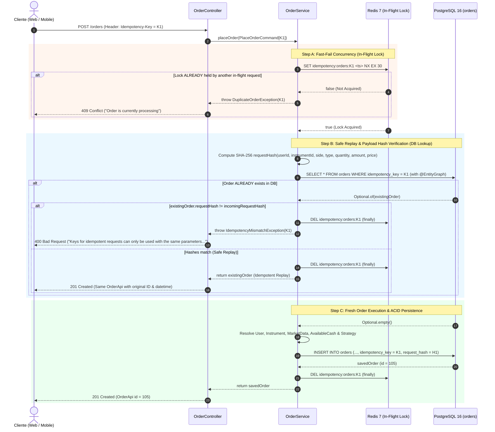
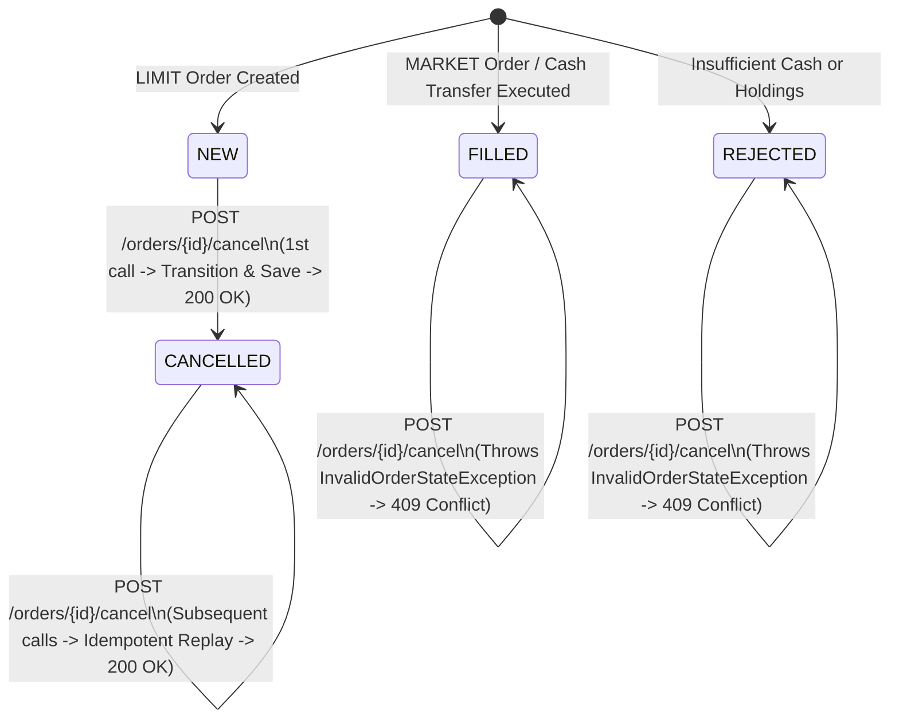

# Plan 010: True Idempotency (Hybrid Redis In-Flight Lock + PostgreSQL `UNIQUE(idempotency_key)` Safe Replay & Idempotent Cancellation)
**Status:** Completed (Build 100% Green, All Tests Verified)
**Context:** Cocos Challenge Trading API
**Architecture:** Multi-Module Pragmatic Service-Driven Architecture (Java 21, Spring Boot 3.3, PostgreSQL 16 + Flyway / `init.sql`, Redis 7 Short-Lived Distributed Lock, Zalando Problem RFC 7807)

---

## 1. Gentle AI & Engram ReAct Loop — Análisis Arquitectónico

### Thought (Diagnóstico de Limitaciones Actuales en Creación y Cancelación)
1. **Problema 1 — Idempotencia Basada Solo en Bloqueo (`409 Conflict`) vs. "True Idempotency" con *Safe Replay* (`POST /orders`)**:
   - Actualmente (Plan 005), `OrderService.placeOrder` utiliza Redis (`SET idempotency:orders:<uuid> <timestamp> NX EX 86400`) como un *bloqueo de rechazo*: si un cliente envía una orden con `Idempotency-Key: K1`, el servidor procesa y persiste la orden `id = 105`, pero la conexión HTTP sufre un *network timeout* antes de que el cliente reciba el response, el cliente no conoce el `id` de su orden.
   - Cuando el cliente reintenta legítimamente el mismo `POST /orders` con `Idempotency-Key: K1`, Redis detecta que la clave existe y lanza `DuplicateOrderException` (`409 Conflict`). Aunque esto evita el *double-spending*, degrada la **Developer Experience (DX)**: el cliente recibe un error `409 Conflict` sin recuperar el objeto `OrderApi` (ni el `id`, `status`, `price` o `datetime`) de la orden que sí se ejecutó exitosamente.
   - Adicionalmente, si Redis se reinicia o la clave expira después de las 24 horas sin un respaldo relacional (`UNIQUE (idempotency_key)` en la tabla `orders`), no existe una garantía ACID definitiva en PostgreSQL ni forma de reconstruir la respuesta original.
2. **Problema 2 — Cancelación No Idempotente (`POST /orders/{orderId}/cancel`)**:
   - Actualmente, `OrderService.cancelOrder(Long orderId)` verifica `if (existingOrder.getStatus() != OrderStatus.NEW)` y arroja `InvalidOrderStateException` (`409 Conflict`) para **cualquier** estado distinto de `NEW`, incluyendo `OrderStatus.CANCELLED`.
   - En sistemas distribuidos y APIs RESTful financieras de primer nivel (Stripe, Adyen, IOL, Cocos Capital), la cancelación de una orden debe ser **idempotente por estado objetivo**:
     - Si la orden está en `NEW` $\rightarrow$ transiciona a `CANCELLED`, se persiste en DB, registra la métrica de negocio y retorna `200 OK` con el `OrderApi` cancelado.
     - Si la orden **ya está en `CANCELLED`** (por ejemplo, ante un reintento de red o doble clic del usuario) $\rightarrow$ el estado deseado por el cliente (`CANCELLED`) ya fue alcanzado. Lanzar una excepción `409 Conflict` obliga al consumidor a escribir lógica defensiva innecesaria. En su lugar, debe comportarse como un **Idempotent Replay**, retornando `200 OK` con la orden en estado `CANCELLED` sin mutar la base de datos ni duplicar métricas en Prometheus.
     - Si la orden está en un **estado terminal incompatible** (`FILLED` o `REJECTED`) $\rightarrow$ no puede cancelarse porque ya fue ejecutada en el mercado o rechazada; en este caso sí corresponde lanzar `InvalidOrderStateException` (`409 Conflict` — `BusinessRuleViolationProblem`).

### Action (Diseño de la Solución: Hybrid Idempotency Flow + Idempotent Cancellation)
1. **Cancelación Idempotente (`OrderService.cancelOrder`)**:
   - Evaluar `existingOrder.getStatus()` mediante un `switch` exhaustivo de Java 21:
     - `case CANCELLED` $\rightarrow$ Loggear el *idempotent replay* y retornar `existingOrder` directamente (`200 OK`) sin invocar `orderRepositoryPort.save(...)` ni `tradingMetricsService.recordOrderProcessed(...)`.
     - `case NEW` $\rightarrow$ Transicionar a `OrderStatus.CANCELLED`, persistir, registrar métricas y retornar `savedOrder` (`200 OK`).
     - `case FILLED, REJECTED` $\rightarrow$ Lanzar `InvalidOrderStateException` (`409 Conflict`).
2. **Migración de Esquema y Persistencia de `idempotency_key` en PostgreSQL**:
   - Incorporar **Flyway** (`flyway-core` + `flyway-database-postgresql`) con migraciones versionadas en `src/main/resources/db/migration/`:
     - `V1__init_schema.sql`: Define el esquema base (`users`, `instruments`, `orders`, `marketdata`) con `CREATE TABLE IF NOT EXISTS` para compatibilidad con bases preexistentes (`baseline-on-migrate: true`).
     - `V2__add_idempotency_key_to_orders.sql`: Agrega la columna `idempotency_key UUID` (o `VARCHAR(64)`) a la tabla `orders` junto con la restricción única `CONSTRAINT uq_orders_idempotency_key UNIQUE (idempotency_key)`. La columna permite `NULL` para las 11 órdenes históricas de *seed* (`id = 1..11`), mientras que en PostgreSQL una restricción `UNIQUE` permite múltiples `NULL` pero garantiza unicidad estricta ACID sobre cualquier `UUID` no nulo.
   - Actualizar también `docker/postgres/init.sql` para que el entorno Docker Compose local refleje desde el arranque la columna `idempotency_key UUID CONSTRAINT uq_orders_idempotency_key UNIQUE`.
   - Mapear `@Column(name = "idempotency_key", unique = true, updatable = false) private UUID idempotencyKey;` en `OrderJpaEntity` y propagarlo desde `PlaceOrderCommand` en `AbstractEquityOrderExecutionStrategy` y `CashTransferExecutionStrategy`.
3. **Flujo Híbrido de Idempotencia en 3 Pasos (`Redis Short-Lived Lock` + `PostgreSQL Safe Replay`)**:
   - **Step A (Fast-Fail In-Flight Concurrency Lock en Redis)**:
     - Intentar adquirir un *lock* efímero en Redis (`IN_FLIGHT_LOCK_TTL = Duration.ofSeconds(30)`) mediante `idempotencyRepositoryPort.tryAcquire(idempotencyKey, IN_FLIGHT_LOCK_TTL)`.
     - Si el *lock* ya está tomado por otro hilo en vuelo (*in-flight*), fallar inmediatamente con `DuplicateOrderException` (`409 Conflict` — `"Order with Idempotency-Key '...' is currently being processed"`).
   - **Step B (Safe Replay & Idempotency Mismatch Validation desde PostgreSQL)**:
     - Una vez adquirido el *lock* efímero, calcular el **hash SHA-256 determinístico** del payload entrante (`userId`, `instrumentId`, `side`, `type`, `quantity`, `amount`, `price`) y consultar `orderRepositoryPort.findByIdempotencyKey(idempotencyKey)` (con `@EntityGraph(attributePaths = {"user", "instrument"})`).
     - Si la orden ya existe en la base de datos:
       - **Validación de Mismatch (Estándar Stripe)**: Comparar el hash entrante contra el `request_hash` persistido. Si difieren (el cliente reutilizó la `Idempotency-Key` pero alteró el `amount`, `quantity`, `instrumentId`, `side`, `type`, `price` o `userId`), lanzar `IdempotencyMismatchException` (`400 Bad Request` — `"Keys for idempotent requests can only be used with the same parameters they were first used with"`).
       - **Safe Replay**: Si los hashes coinciden, **retornar inmediatamente la entidad persistida** sin re-ejecutar estrategias ni volver a insertar en la base de datos.
   - **Step C (Ejecución Transaccional y Persistencia ACID)**:
     - Si la orden no existe en la base de datos, ejecutar `executePlaceOrder(command)` y guardar la nueva `OrderJpaEntity` incluyendo `idempotencyKey` y `requestHash` (protegida además en última instancia por el constraint `uq_orders_idempotency_key` de PostgreSQL).
   - **Bloque `finally` (Liberación Determinística del Lock en Redis)**:
     - Al finalizar el bloque `try` (tanto tras un *Safe Replay* en Step B, una creación exitosa en Step C, o un *rollback* por excepción), liberar el *lock* en Redis (`idempotencyRepositoryPort.release(idempotencyKey)`). Así, Redis actúa exclusivamente como **semáforo distribuido para ráfagas en vuelo (*in-flight concurrency*)**, mientras que PostgreSQL actúa como **fuente de verdad permanente (*System of Record*) para *Safe Replay***.

### Observation (Verificación de Garantías e Invariantes)
- **Ráfaga Concurrente (*In-Flight Race Condition*)**: Si 10 hilos envían el mismo `Idempotency-Key` en el mismo milisegundo, 1 hilo adquiere el *lock* en Redis (Step A) y procesa la orden; los 9 hilos que colisionan mientras el primero está en vuelo reciben `409 Conflict` (`"Order is currently processing"`).
- **Reintento Secuencial tras Timeout (*Safe Replay*)**: Cuando el cliente reintenta la petición tras haber finalizado la primera transacción, adquiere el *lock* libre en Step A, encuentra la orden ya persistida en Step B (`findByIdempotencyKey`), libera el *lock* en `finally` y recibe la respuesta con el **mismo `OrderApi` (`id`, `status`, `price`/`amount`, `datetime`)** sin duplicar órdenes ni afectar su saldo disponible.
- **Cancelación Idempotente (`POST /orders/{id}/cancel`)**: Llamar $N$ veces seguidas a `POST /orders/5/cancel` sobre una orden que inició en `NEW` retorna `200 OK` con `status: "CANCELLED"` en las $N$ invocaciones, mientras que cancelar una orden `FILLED` o `REJECTED` sigue retornando `409 Conflict`.

---

## 2. Diagramas de Flujo Arquitectónico

### 2.1. Flujo Híbrido de Creación Idempotente (`POST /orders` — Redis + PostgreSQL)



### 2.2. Máquina de Estados para Cancelación Idempotente (`POST /orders/{orderId}/cancel`)



---

## 3. Detalle de Cambios por Componente

### 3.1. Upgrade 1: Cancelación Idempotente de Órdenes (`POST /orders/{orderId}/cancel`)

*   **[OrderService.java](file:///Users/richard/environment/workspace-richard/cocos-challenge-trading-api/cocos-trading-service/src/main/java/com/cocos/trading/application/service/OrderService.java):**
    *   Refactorizar `cancelOrder(Long orderId)` para distinguir claramente entre:
        1. **`OrderStatus.CANCELLED` (*Idempotent Replay*)**: No arrojar excepción, no volver a hacer `save(...)` en la base de datos y no incrementar nuevamente el contador `cocos_orders_processed_total` en Micrometer. Retornar directamente `existingOrder` para que `OrderController` devuelva `200 OK` con el payload `OrderApi`.
        2. **`OrderStatus.NEW` (*Transición Normal*)**: Cambiar estado a `OrderStatus.CANCELLED`, persistir mediante `orderRepositoryPort.save(existingOrder)`, registrar la métrica en `tradingMetricsService` y retornar `savedOrder` (`200 OK`).
        3. **`OrderStatus.FILLED` o `OrderStatus.REJECTED` (*Estados Terminales Incompatibles*)**: Lanzar `InvalidOrderStateException` (traducida por `GlobalExceptionHandler` a `409 Conflict` / `BusinessRuleViolationProblem`).
    *   **Implementación proyectada en `OrderService.cancelOrder`**:
        ```java
        @Override
        @Transactional
        public OrderJpaEntity cancelOrder(Long orderId) {
            log.info("[order] Cancelling orderId={}", orderId);

            OrderJpaEntity existingOrder = orderRepositoryPort.findById(orderId)
                    .orElseThrow(() -> new ResourceNotFoundException("Order", orderId));

            return switch (existingOrder.getStatus()) {
                case CANCELLED -> {
                    log.info("[order] Idempotent cancellation replay for already CANCELLED orderId={}", orderId);
                    yield existingOrder;
                }
                case NEW -> {
                    existingOrder.setStatus(OrderStatus.CANCELLED);
                    OrderJpaEntity savedOrder = orderRepositoryPort.save(existingOrder);

                    tradingMetricsService.recordOrderProcessed(
                            savedOrder.getStatus().name(),
                            savedOrder.getType().name(),
                            savedOrder.getSide().name()
                    );

                    log.info("[order] Cancelled orderId={}", savedOrder.getId());
                    yield savedOrder;
                }
                case FILLED, REJECTED -> throw new InvalidOrderStateException(
                        orderId,
                        existingOrder.getStatus(),
                        String.format(
                                "Cannot cancel order with terminal status %s. Only orders with status NEW can be cancelled.",
                                existingOrder.getStatus()
                        )
                );
            };
        }
        ```
*   **[OrderContractApi.java](file:///Users/richard/environment/workspace-richard/cocos-challenge-trading-api/cocos-trading-contract/src/main/java/com/cocos/trading/api/OrderContractApi.java):**
    *   Actualizar la descripción `@Operation` de `cancel(Long orderId)` en OpenAPI/Swagger para documentar explícitamente la semántica idempotente:
        *   `NEW` $\rightarrow$ `200 OK` (transiciona a `CANCELLED`).
        *   `CANCELLED` $\rightarrow$ `200 OK` (*Idempotent replay*, retorna la orden ya cancelada sin error).
        *   `FILLED` / `REJECTED` $\rightarrow$ `409 Conflict` (`Invalid Order State`).

---

### 3.2. Upgrade 2: Migración de Base de Datos y Mapeo JPA para `idempotency_key` (`POST /orders`)

#### A. Estrategia de Migración de Esquema (Flyway + `init.sql`)
1.  **Dependencias Flyway en [cocos-trading-service/pom.xml](file:///Users/richard/environment/workspace-richard/cocos-challenge-trading-api/cocos-trading-service/pom.xml):**
    *   Agregar `org.flywaydb:flyway-core` y `org.flywaydb:flyway-database-postgresql` (gestionados por el BOM de Spring Boot 3.3.0).
2.  **Scripts de Migración Flyway en `cocos-trading-service/src/main/resources/db/migration/`:**
    *   **`V1__init_schema.sql`**: Define de forma idempotente (`CREATE TABLE IF NOT EXISTS`) las tablas base `users`, `instruments`, `orders` y `marketdata`.
    *   **`V2__add_idempotency_key_to_orders.sql`**:
        ```sql
        -- =============================================================================
        -- Migration V2: Add idempotency_key (UNIQUE) and request_hash to orders table
        -- =============================================================================
        ALTER TABLE orders
            ADD COLUMN IF NOT EXISTS idempotency_key UUID,
            ADD COLUMN IF NOT EXISTS request_hash VARCHAR(256);

        DO $$
        BEGIN
            IF NOT EXISTS (
                SELECT 1
                FROM pg_constraint
                WHERE conname = 'uq_orders_idempotency_key'
            ) THEN
                ALTER TABLE orders
                    ADD CONSTRAINT uq_orders_idempotency_key UNIQUE (idempotency_key);
            END IF;
        END $$;
        ```
        > [!NOTE]
        > **Compatibilidad con Datos de Seed (`NULL` en filas históricas)**: En PostgreSQL (estándar SQL), un constraint `UNIQUE (idempotency_key)` permite que las 11 filas históricas de *seed* (`id = 1..11`) tengan `idempotency_key = NULL` y `request_hash = NULL`, mientras garantiza unicidad estricta e índice `B-Tree` de búsqueda rápida $O(\log N)$ para todas las órdenes creadas vía API con un `UUID` no nulo.
3.  **Actualización de [docker/postgres/init.sql](file:///Users/richard/environment/workspace-richard/cocos-challenge-trading-api/docker/postgres/init.sql):**
    *   Incluir `idempotency_key UUID CONSTRAINT uq_orders_idempotency_key UNIQUE` y `request_hash VARCHAR(256)` directamente en la definición `CREATE TABLE IF NOT EXISTS orders (...)` para mantener paridad inmediata al inicializar el contenedor `cocos-postgres`.
4.  **Configuración de Flyway por Perfil (`application.yml`, `application-local.yml`, `application-test.yml`, `application-prod.yml`):**
    *   En `application.yml`: habilitar Flyway con `baseline-on-migrate: true` y `baseline-version: 1` para que cuando se conecte a una base ya inicializada por `init.sql`, aplique limpiamente `V2__add_idempotency_key_to_orders.sql` y valide el esquema con Hibernate (`ddl-auto: validate`).

#### B. Actualización de Entidades JPA y Estrategias de Ejecución
1.  **[OrderJpaEntity.java](file:///Users/richard/environment/workspace-richard/cocos-challenge-trading-api/cocos-trading-service/src/main/java/com/cocos/trading/repository/entity/OrderJpaEntity.java):**
    *   Eliminar el bloque `// TODO` obsoleto sobre la falta de columna `idempotency_key` y agregar el mapeo de columnas:
        ```java
        @Column(name = "idempotency_key", unique = true, updatable = false)
        private UUID idempotencyKey;

        @Column(name = "request_hash", length = 256, updatable = false)
        private String requestHash;
        ```
2.  **[TradeOrderJpaEntity.java](file:///Users/richard/environment/workspace-richard/cocos-challenge-trading-api/cocos-trading-service/src/main/java/com/cocos/trading/repository/entity/TradeOrderJpaEntity.java) y [TransferOrderJpaEntity.java](file:///Users/richard/environment/workspace-richard/cocos-challenge-trading-api/cocos-trading-service/src/main/java/com/cocos/trading/repository/entity/TransferOrderJpaEntity.java):**
    *   Heredan automáticamente `.idempotencyKey(...)` a través de `@SuperBuilder(toBuilder = true)`. Actualizar o sobrecargar los constructores con argumentos usados en tests si corresponde.
3.  **[AbstractEquityOrderExecutionStrategy.java](file:///Users/richard/environment/workspace-richard/cocos-challenge-trading-api/cocos-trading-service/src/main/java/com/cocos/trading/application/strategy/AbstractEquityOrderExecutionStrategy.java) y [CashTransferExecutionStrategy.java](file:///Users/richard/environment/workspace-richard/cocos-challenge-trading-api/cocos-trading-service/src/main/java/com/cocos/trading/application/strategy/CashTransferExecutionStrategy.java):**
    *   Al construir `TradeOrderJpaEntity.builder()` y `TransferOrderJpaEntity.builder()`, propagar `.idempotencyKey(command.idempotencyKey())`.
    *   *(Nota adicional de limpieza)*: En `CashTransferExecutionStrategy.java`, corregir las líneas duplicadas residuales (`resolvedSize` vs. `resolvedQuantity`) para dejar únicamente `resolvedQuantity`.

#### C. Actualización de Puertos y Repositorios de Persistencia
1.  **[OrderRepositoryPort.java](file:///Users/richard/environment/workspace-richard/cocos-challenge-trading-api/cocos-trading-service/src/main/java/com/cocos/trading/application/port/out/OrderRepositoryPort.java):**
    *   Agregar el método de consulta por clave de idempotencia:
        ```java
        /**
         * Finds an order by its unique client-provided idempotency key.
         *
         * @param idempotencyKey The UUID idempotency key.
         * @return An {@link Optional} containing the persisted {@link OrderJpaEntity} if found.
         */
        Optional<OrderJpaEntity> findByIdempotencyKey(UUID idempotencyKey);
        ```
2.  **[SpringDataOrderRepository.java](file:///Users/richard/environment/workspace-richard/cocos-challenge-trading-api/cocos-trading-service/src/main/java/com/cocos/trading/repository/jpa/SpringDataOrderRepository.java):**
    *   Declarar la query derivada con `@EntityGraph` para hidratar `user` e `instrument` en un único `JOIN` SQL durante el *Safe Replay*:
        ```java
        @EntityGraph(attributePaths = {"user", "instrument"})
        Optional<OrderJpaEntity> findByIdempotencyKey(UUID idempotencyKey);
        ```
3.  **[OrderRepositoryAdapter.java](file:///Users/richard/environment/workspace-richard/cocos-challenge-trading-api/cocos-trading-service/src/main/java/com/cocos/trading/repository/OrderRepositoryAdapter.java):**
    *   Implementar `findByIdempotencyKey(UUID idempotencyKey)` delegando en `springDataOrderRepository.findByIdempotencyKey(idempotencyKey)`.

---

### 3.3. Upgrade 3: Flujo Híbrido de Idempotencia en `OrderService` (Redis + PostgreSQL)

*   **[OrderService.java](file:///Users/richard/environment/workspace-richard/cocos-challenge-trading-api/cocos-trading-service/src/main/java/com/cocos/trading/application/service/OrderService.java):**
    *   Reemplazar la constante `IDEMPOTENCY_TTL` de 24h por un TTL corto de bloqueo en vuelo:
        ```java
        public static final Duration IN_FLIGHT_LOCK_TTL = Duration.ofSeconds(30);
        ```
    *   **Hashing Determinístico SHA-256 (`RequestHashUtils` / `OrderService`)**:
        *   Generar un hash SHA-256 (codificado en hex de 64 caracteres) combinando de forma canónica los campos críticos del payload (`userId`, `instrumentId`, `side`, `type`, `quantity`, `amount` normalizado a 2 decimales + divisa, `price` normalizado a 2 decimales + divisa).
    *   **Validación de Mismatch (`IdempotencyMismatchException` $\rightarrow$ `400 Bad Request`)**:
        *   Crear `IdempotencyMismatchException` en `com.cocos.trading.domain.exception` con el mensaje estándar Stripe: `"Keys for idempotent requests can only be used with the same parameters they were first used with"`.
        *   Mapearla en [GlobalExceptionHandler.java](file:///Users/richard/environment/workspace-richard/cocos-challenge-trading-api/cocos-trading-service/src/main/java/com/cocos/trading/controller/handler/GlobalExceptionHandler.java) a HTTP `400 Bad Request` (`BadRequestProblem` con `parameters: { idempotencyKey: ... }`).
    *   Implementar el flujo de 3 pasos (**Step A: Fast-Fail Concurrency Lock**, **Step B: Safe Database Replay & Mismatch Check**, **Step C: Order Execution & Persistence**) con liberación del lock de Redis en bloque `finally`:
        ```java
        @Override
        @Transactional
        public OrderJpaEntity placeOrder(PlaceOrderCommand command) {
            UUID idempotencyKey = command.idempotencyKey();
            String requestHash = RequestHashUtils.sha256(command);

            // Step A (Fast-Fail Concurrency): Acquire short-lived in-flight lock in Redis
            if (idempotencyKey != null) {
                boolean acquired = idempotencyRepositoryPort.tryAcquire(idempotencyKey, IN_FLIGHT_LOCK_TTL);
                if (!acquired) {
                    log.warn("[order] Rejecting concurrent in-flight order submission for idempotencyKey={}", idempotencyKey);
                    throw new DuplicateOrderException(idempotencyKey);
                }
            }

            try {
                // Step B (Safe Replay & Mismatch Validation): Check if order was already persisted in PostgreSQL
                if (idempotencyKey != null) {
                    Optional<OrderJpaEntity> existingOrder = orderRepositoryPort.findByIdempotencyKey(idempotencyKey);
                    if (existingOrder.isPresent()) {
                        OrderJpaEntity persisted = existingOrder.get();
                        if (persisted.getRequestHash() != null && !persisted.getRequestHash().equals(requestHash)) {
                            log.warn("[order] Idempotency mismatch for idempotencyKey={}: payload hash differs from original request",
                                    idempotencyKey);
                            throw new IdempotencyMismatchException(idempotencyKey);
                        }
                        log.info("[order] Idempotent replay returning existing orderId={} for idempotencyKey={}",
                                persisted.getId(), idempotencyKey);
                        return persisted;
                    }
                }

                // Step C (Execution): Process order business logic and persist with idempotency_key + request_hash
                return executePlaceOrder(command, requestHash);
            } finally {
                if (idempotencyKey != null) {
                    idempotencyRepositoryPort.release(idempotencyKey);
                }
            }
        }
        ```
*   **[DuplicateOrderException.java](file:///Users/richard/environment/workspace-richard/cocos-challenge-trading-api/cocos-trading-service/src/main/java/com/cocos/trading/domain/exception/DuplicateOrderException.java):**
    *   Actualizar el mensaje de error para reflejar con precisión la colisión de concurrencia en vuelo (*in-flight lock*):
        ```java
        "Order with Idempotency-Key '%s' is currently being processed. Please wait for the in-flight request to complete or retry."
        ```

---

### 3.4. Upgrade 4: Estrategia de Testing, Colección de Postman y `README.md`

#### A. Unit Tests ([OrderServiceTest.java](file:///Users/richard/environment/workspace-richard/cocos-challenge-trading-api/cocos-trading-service/src/test/java/com/cocos/trading/application/service/OrderServiceTest.java))
1.  **Tests de Cancelación Idempotente (`POST /orders/{id}/cancel`)**:
    *   `shouldCancelOrderWhenStatusIsNew`: Verifica que una orden `NEW` cambia a `CANCELLED`, invoca `orderRepositoryPort.save(...)` y registra la métrica `cocos_orders_processed_total{status="CANCELLED"}`.
    *   `shouldReturnExistingCancelledOrderOnIdempotentReplayWithoutError`: Verifica que cuando `orderRepositoryPort.findById(50L)` retorna una orden que **ya tiene estado `CANCELLED`**, `orderService.cancelOrder(50L)` retorna `200 OK` (la entidad con `status == CANCELLED`) sin lanzar `InvalidOrderStateException`, sin invocar `orderRepositoryPort.save(...)` y sin incrementar métricas por segunda vez.
    *   `shouldRejectCancellationWhenOrderIsFilledOrRejected`: Verifica que cancelar una orden en estado terminal `FILLED` o `REJECTED` continúa lanzando `InvalidOrderStateException`.
2.  **Tests del Flujo Híbrido de Creación (`POST /orders`)**:
    *   **Step A (`shouldRejectConcurrentInFlightOrderWhenRedisLockIsHeld`)**: Cuando `idempotencyRepositoryPort.tryAcquire(key, IN_FLIGHT_LOCK_TTL)` retorna `false`, lanza `DuplicateOrderException` (`409 Conflict`), nunca consulta `findByIdempotencyKey` ni ejecuta `save(...)`, y **no** libera el lock ajeno.
    *   **Step B (`shouldReturnPersistedOrderOnSafeIdempotentReplayWhenFoundInDatabase`)**: Cuando `tryAcquire` retorna `true` y `orderRepositoryPort.findByIdempotencyKey(key)` retorna `Optional.of(persistedOrder)` con el mismo `requestHash`, `placeOrder` retorna inmediatamente `persistedOrder` (mismo `id`, `status`, `quantity`, `price`), verifica `verify(orderRepositoryPort, never()).save(any())`, y verifica que `idempotencyRepositoryPort.release(key)` se invoca en el `finally`.
    *   **Step B Mismatch (`shouldThrowIdempotencyMismatchExceptionWhenPayloadDiffersForSameKey`)**: Cuando `findByIdempotencyKey(key)` retorna una orden cuyo `requestHash` difiere del payload actual (ej. cambió `quantity` o `amount`), lanza `IdempotencyMismatchException` (`400 Bad Request`), no persiste nada y libera el lock en `finally`.
    *   **Step C (`shouldPersistIdempotencyKeyAndRequestHashOnFreshOrderAndReleaseRedisLock`)**: Cuando `tryAcquire` retorna `true` y `findByIdempotencyKey(key)` retorna `Optional.empty()`, ejecuta la estrategia, guarda la entidad con `idempotencyKey` y `requestHash` SHA-256 y libera el lock en Redis al finalizar.
    *   **Concurrencia Multi-Hilo (`shouldPreventDoubleSpendingUnderConcurrentBurstAndReplayAfterCompletion`)**: Verifica con `VirtualThreads` y `CountDownLatch` que ante una ráfaga concurrente con la misma `Idempotency-Key`, exactamente 1 hilo ejecuta `orderRepositoryPort.save(...)`, los hilos que colisionan en vuelo reciben `DuplicateOrderException`, y un reintento posterior tras completarse la orden recibe el *Safe Replay* desde `findByIdempotencyKey`.

#### B. Integration Tests ([OrderControllerIT.java](file:///Users/richard/environment/workspace-richard/cocos-challenge-trading-api/cocos-trading-service/src/it/java/com/cocos/trading/controller/OrderControllerIT.java))
1.  **`shouldCreateLimitOrderAsNewAndSupportIdempotentCancellationReplay`**:
    *   Crea una orden `LIMIT BUY` (`status = NEW`, `id = createdOrderId`).
    *   **1ra llamada** a `POST /orders/{orderId}/cancel` $\rightarrow$ retorna `200 OK` con `status = "CANCELLED"`.
    *   **2da llamada (Replay)** a `POST /orders/{orderId}/cancel` $\rightarrow$ retorna `200 OK` con el mismo `id` y `status = "CANCELLED"` (sin error `409`).
    *   Verifica que intentar cancelar una orden `FILLED` o `REJECTED` retorna `409 Conflict` (`Invalid Order State`).
2.  **`shouldPersistIdempotencyKeyAndRequestHashInDatabaseReplaySamePayloadAndRejectMismatch`**:
    *   Envía un **1er `POST /orders`** (`CASH_IN` de `25,000.00 ARS`) con `Idempotency-Key: <uuid>`.
    *   Verifica que responde `201 Created` y que en PostgreSQL la fila tiene `idempotency_key = <uuid>` y `request_hash` SHA-256 no nulo.
    *   Verifica que el lock efímero en Redis ya fue liberado tras completar la transacción (`stringRedisTemplate.hasKey(redisKey) == false`).
    *   Envía un **2do `POST /orders` secuencial** con el **mismo `Idempotency-Key` y mismo payload** (simulando reintento del cliente tras timeout) $\rightarrow$ retorna `201 Created` con el **mismo `id`, `status` y `datetime`** (*Safe Replay*).
    *   Envía un **3er `POST /orders` secuencial** con el **mismo `Idempotency-Key` pero distinto payload** (ej. `50,000.00 ARS` en vez de `25,000.00 ARS`) $\rightarrow$ retorna `400 Bad Request` (`BadRequestProblem` con `"Keys for idempotent requests can only be used with the same parameters they were first used with"`), y verifica que `orderRepository.findAll().size()` sigue siendo `2`.
3.  **`shouldPreventConcurrentDoubleSpendingWithSameIdempotencyKey`**:
    *   Ejecuta 10 peticiones concurrentes con la misma `Idempotency-Key`.
    *   Verifica que en PostgreSQL se inserta **exactamente 1 orden** (`orderRepository.findAll().size() == 2`), mientras que las peticiones que colisionaron en vuelo reciben `409 Conflict` (y cualquier petición que entre luego de liberarse el lock recibe el *Safe Replay* de esa única orden).

#### C. Actualización de la Colección de Postman ([cocos-trading-api.postman_collection.json](file:///Users/richard/environment/workspace-richard/cocos-challenge-trading-api/cocos-trading-api.postman_collection.json))
1.  **Carpeta `2. Trade Orders (Market & Limit)` $\rightarrow$ Request `2.5 Cancel Pending (NEW) Order`**:
    *   Actualizar la descripción y agregar un segundo ejemplo de respuesta guardado (`Saved Response`):
        *   Ejemplo 1: `200 OK — Order Cancelled (Transition from NEW to CANCELLED)`.
        *   Ejemplo 2: `200 OK — Idempotent Replay (Order Already CANCELLED)`.
2.  **Carpeta `4. Validation & Edge Cases (Sad Paths)`**:
    *   Actualizar **`4.1 Transfer — Unsupported Currency USD (400 Bad Request)`** y **`4.2 Transfer — Invalid Unknown Field 'quantity' or 'price' (400 Bad Request)`** con los mensajes DX refinados y específicos del dominio.
    *   Actualizar **`4.8 Idempotency — Safe Order Replay & In-Flight Concurrency Protection`**:
        *   Documentar el flujo híbrido completo cuando se reenvía el header estático `Idempotency-Key: 123e4567-e89b-12d3-a456-426614174000`:
            *   **Saved Response 1 (`201 Created` — Safe Idempotent Replay from PostgreSQL)**: Demuestra cómo al volver a ejecutar el request una vez procesada la orden, la API devuelve de forma segura la orden original persistida en PostgreSQL (mismo `id` y `datetime`) sin duplicar el cargo.
            *   **Saved Response 2 (`409 Conflict` — In-Flight Concurrency Lock via Redis)**: Demuestra la respuesta RFC 7807 cuando dos peticiones idénticas colisionan en el mismo milisegundo mientras la primera aún está en vuelo.
    *   Agregar **`4.9 Cancel Order — Cannot Cancel Terminal FILLED or REJECTED Order (409 Conflict)`** (junto con la nota de que cancelar una orden ya `CANCELLED` responde `200 OK`).
    *   Agregar **`4.10 Idempotency — Payload Mismatch with Reused Key (400 Bad Request)`** demostrando el rechazo estilo Stripe cuando se reutiliza un `Idempotency-Key` con parámetros modificados (`quantity` o `amount` distinto).

#### D. Actualización de Documentación ([README.md](file:///Users/richard/environment/workspace-richard/cocos-challenge-trading-api/README.md))
1.  **Sección `1. Tech Stack`**: Actualizar la descripción de **Redis 7** y **PostgreSQL 16 + Flyway** para describir la arquitectura de **True Hybrid Idempotency** (Redis para *Fast-Fail In-Flight Locking* + PostgreSQL `UNIQUE(idempotency_key)` + `request_hash` SHA-256 para *Durable Safe Replay*).
2.  **Sección `3.7. True Idempotency & Concurrency Control (Hybrid Redis In-Flight Lock + PostgreSQL Safe Replay + Stripe-Style Mismatch Validation + Idempotent Cancellation)`**:
    *   Documentar explícitamente la validación de **Idempotency Mismatch** estilo Stripe (`request_hash` SHA-256 sobre el payload polimórfico $\rightarrow$ `400 Bad Request` si los parámetros difieren), el flujo híbrido de 3 pasos (**Step A**, **Step B**, **Step C**) y la **Cancelación Idempotente** en `POST /orders/{orderId}/cancel`.
3.  **Sección `6. API Endpoints & Ejemplos cURL`**:
    *   Actualizar las notas de `POST /orders` y `POST /orders/{orderId}/cancel` reflejando el comportamiento de *Safe Replay*, *Idempotency Mismatch* (`400 Bad Request`) y *Idempotent Cancellation* (`200 OK`).

---

### 3.5. Upgrade 5: Refinamientos de DX en Mensajes de Validación y Jackson (`400 Bad Request`)

Para elevar la experiencia de integración (*Developer Experience*) en los *Sad Paths* de transferencias (`CASH_IN` / `CASH_OUT`):
1. **Moneda no soportada (`OrderCreateRequestValidator` + `ValidatorUtils`)**:
   - Cuando `TransferOrderRequestApi` recibe un `amount.currency` distinto de `"ARS"` (por ejemplo, `"USD"`), se extrae dinámicamente la divisa rechazada y se responde con:
     `Currency '<currency>' is not supported. Only 'ARS' transfers are currently allowed.` (resultando en `"Validation failed: Currency 'USD' is not supported. Only 'ARS' transfers are currently allowed."` en el campo `detail` de `BadRequestProblem`).
2. **Campo desconocido en Transferencia (`GlobalExceptionHandler` + Jackson `UnrecognizedPropertyException`)**:
   - Cuando un payload de `TransferOrderRequestApi` incluye campos propios de órdenes bursátiles como `quantity` o `price`, `GlobalExceptionHandler` inspecciona `ex.getReferringClass()` y responde con el mensaje contextual:
     `Unrecognized field '<field>'. Cash transfers (CASH_IN/CASH_OUT) only accept 'userId', 'side', and 'amount'.`

---

## 4. Checklist de Ejecución (Post-Aprobación)

- [x] **Paso 1**: Agregar dependencias de Flyway en `cocos-trading-service/pom.xml`, crear `V1__init_schema.sql` y `V2__add_idempotency_key_to_orders.sql`, y actualizar `docker/postgres/init.sql` y archivos `application*.yml`.
- [x] **Paso 2**: Mapear `idempotencyKey` y `requestHash` en `OrderJpaEntity`, propagarlos en estrategias (`AbstractEquityOrderExecutionStrategy`, `CashTransferExecutionStrategy`) y exponer `findByIdempotencyKey(UUID)` con `@EntityGraph` en `SpringDataOrderRepository`, `OrderRepositoryPort` y `OrderRepositoryAdapter`.
- [x] **Paso 3**: Implementar la lógica de **Cancelación Idempotente** (`NEW` $\rightarrow$ `CANCELLED` `200 OK`, `CANCELLED` $\rightarrow$ `200 OK` *replay*, `FILLED`/`REJECTED` $\rightarrow$ `409 Conflict`) y el **Flujo Híbrido de 3 Pasos** + validación de **Idempotency Mismatch (`request_hash` SHA-256)** en `OrderService`.
- [x] **Paso 4**: Implementar los refinamientos DX de mensajes de error (`OrderCreateRequestValidator`, `ValidatorUtils`, `GlobalExceptionHandler`) para monedas no soportadas y campos desconocidos en transferencias.
- [x] **Paso 5**: Actualizar y ampliar `OrderServiceTest` y `OrderControllerIT`, ejecutando `mvn clean verify` hasta obtener **100% de tests en verde**.
- [x] **Paso 6**: Actualizar `cocos-trading-api.postman_collection.json` (incluyendo `4.1`, `4.2`, `4.8`, `4.9`, `4.10`) y `README.md`.

